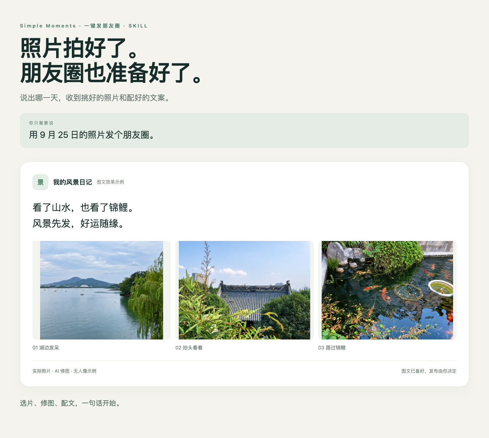
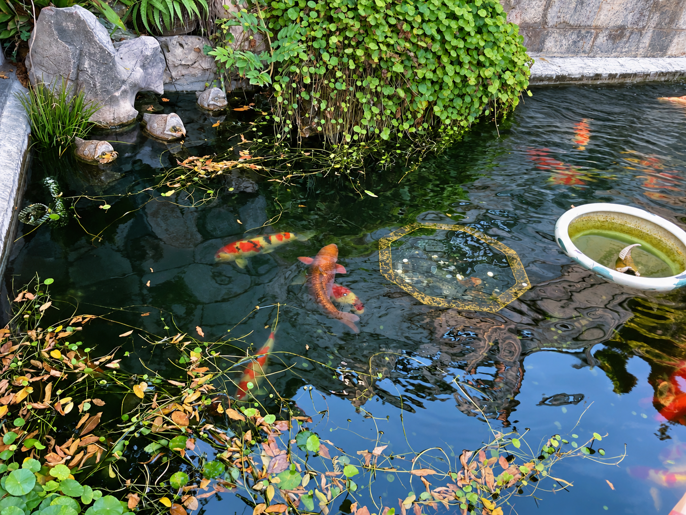
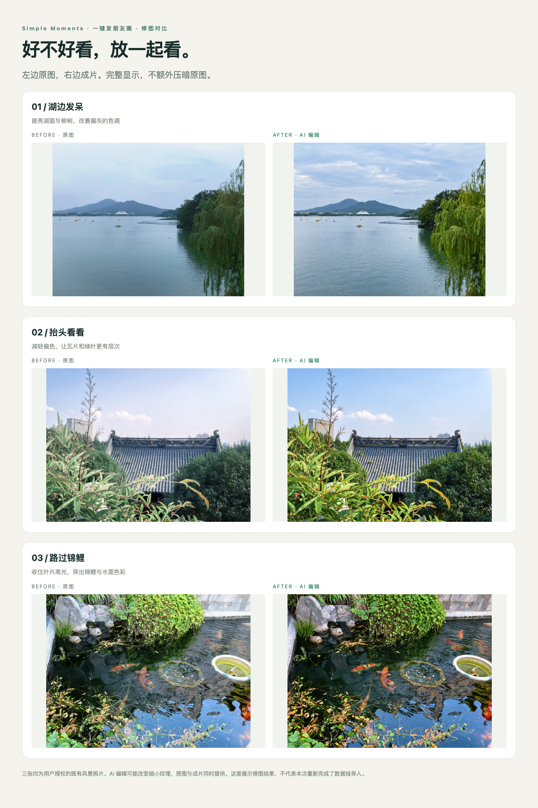

# Simple Moments · 一键发朋友圈

**你负责出去玩，它负责把这条朋友圈准备好。**

照片拍了一堆，发朋友圈却卡在选哪张、怎么修、写什么。现在把手机或 iPad 连上电脑，跟 AI 说一句就能开始。

> 用昨天的照片发个朋友圈。

它会按日期找照片，挑出值得发的一组，修好、排好顺序，再配一段有意思的文字。你拿到成片和文案，最后自己点发布。

## 一句话，能拿到什么

- **挑好的照片**。相似的几张里选更合适的，默认精选 3～9 张，好照片少就少发。
- **修好的成片**。调整明暗和颜色，让一组照片放在一起更协调，原图另存。
- **能直接复制的文案**。有简短的，也有带点小幽默的，不用对着输入框发呆。
- **修前修后对比**。哪里变了，看图就知道。

## 先看一次真实示例

下面用的是此前按 2026 年 9 月 25 日归档的三张风景照。本次使用已经导入电脑的照片，实际完成了 AI 修图、配文和展示排版。所有示例都未使用人像照。

> 用 9 月 25 日的照片发个朋友圈，只要风景，文案有意思一点。

三张一起发，可以这样写。

> 看了山水，也看了锦鲤。
> 风景先发，好运随缘。

只想发一张，也给你配好了。

### 这张适合发呆

> 这张适合发呆，不适合配长文。

想再俏皮一点，可以用“湖面这么宽，容我发一会儿呆。”

### 抬头就有收获

> 屋顶负责好看，我负责抬头。

更短一点，“抬头营业，低头赶路。”

### 顺便沾点光

> 锦鲤负责游，我负责沾点光。

想和朋友互动，可以用“路过几条锦鲤，顺手给大家看看。”

## 修前修后，放一起看

左边是原图，右边是本次 AI 编辑的成片。对比两侧使用相同的展示区域，完整显示照片；原图没有额外压暗或调灰。

湖面变得更明亮，屋檐和绿叶的层次更清楚，锦鲤的颜色更突出。本组采用生成式编辑，除明暗颜色外，湖面样例的云层和水纹也有变化；对细节有保真要求时请核对原图。

[打开全部原图](examples/before/) · [拿走三张成片](examples/after/) · [复制示例文案](examples/朋友圈文案.md)

## 你可以这样说

| 想做什么 | 直接说 |
| --- | --- |
| 发昨天的照片 | 用昨天的照片发个朋友圈。 |
| 补发某一天 | 用 2026 年 9 月 25 日的照片发个朋友圈。 |
| 只选风景 | 用那天的照片发个朋友圈，只要风景。 |
| 想轻松一点 | 用昨天的照片发个朋友圈，文案有意思一点。 |
| 不想发太多 | 用昨天的照片发个朋友圈，三张就好。 |
| 照片已经导入 | 用这个文件夹里的照片发个朋友圈。 |

看完成果后，也可以接着说“换掉第二张”“颜色自然一点”“文案再短点”。不用重新交代整件事。

## 怎么用起来

这是给 AI 助手使用的 skill。安装一次，以后就能用日常说话的方式调用。

1. 把包里的 `simple-moments` 文件夹交给 Codex，告诉它“帮我安装这个 skill”。
2. 用数据线连接手机或 iPad。照片已经在电脑里，也可以直接给文件夹。
3. 说“用昨天的照片发个朋友圈”，等它交付图片和文案。

如果需要明确指定技能，可以说“用一键发朋友圈，整理昨天的照片”，或输入 `$simple-moments`。

当前提供 Mac 版数据线读取脚本，运行环境需要能访问本地文件并调用图像编辑工具。Windows 和安卓数据线导入尚未验证；已经导入的照片可以直接使用。本次展示验证了本地风景照编辑流程，完整的数据线到成片流程仍待设备实测。

读取脚本保留设备原片。修图使用当前 AI 环境的图像工具，实际用量和费用随所用服务而定。遇到确实读不到照片的情况，助手会说明原因。

[技能文件](simple-moments/SKILL.md) · [示例制作记录与修图提示词](examples/制作记录.json)
